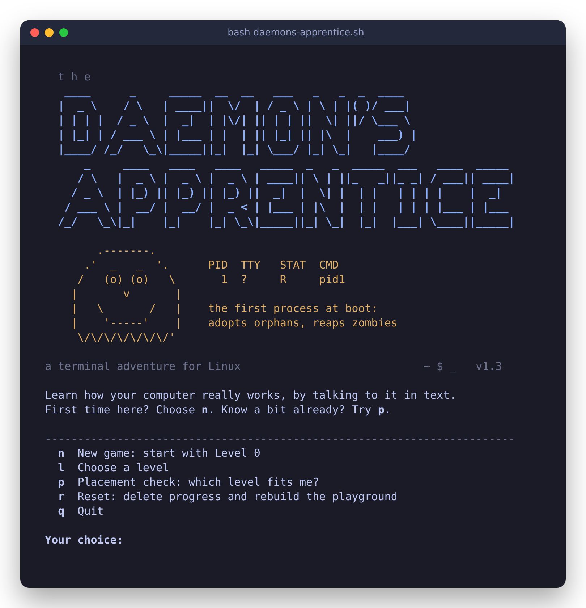
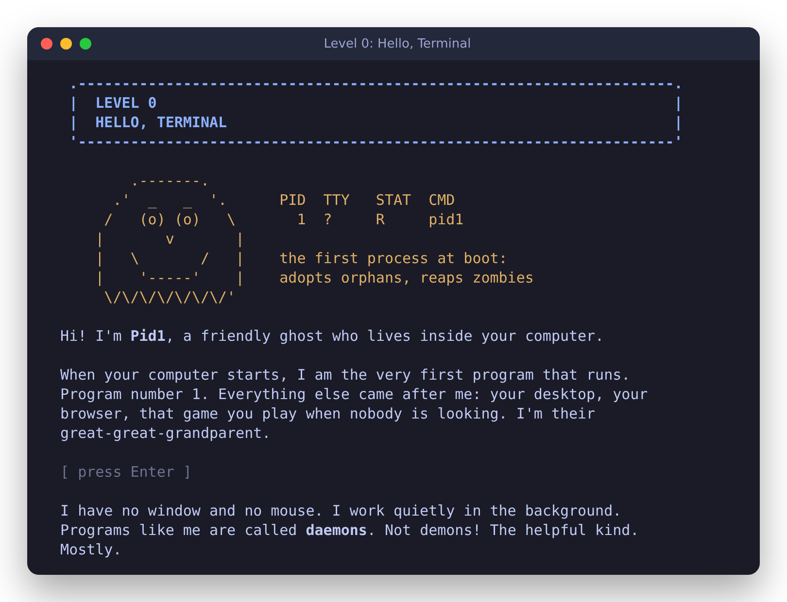
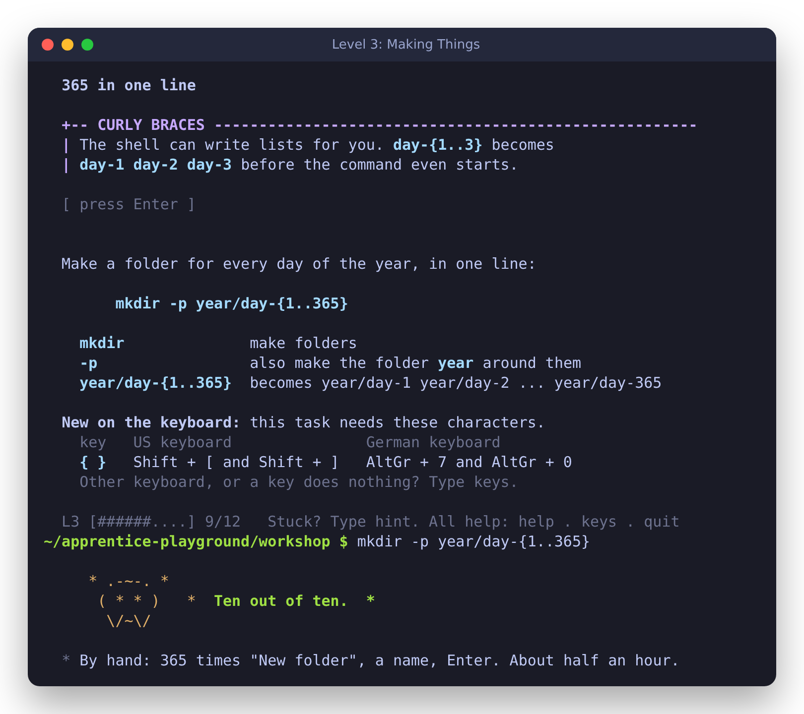
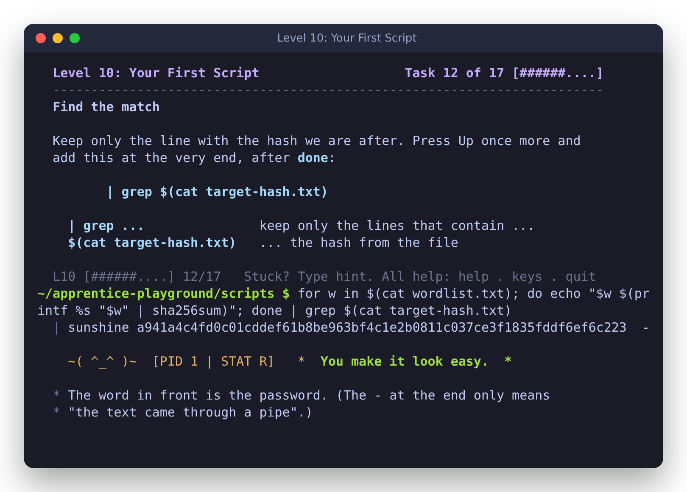
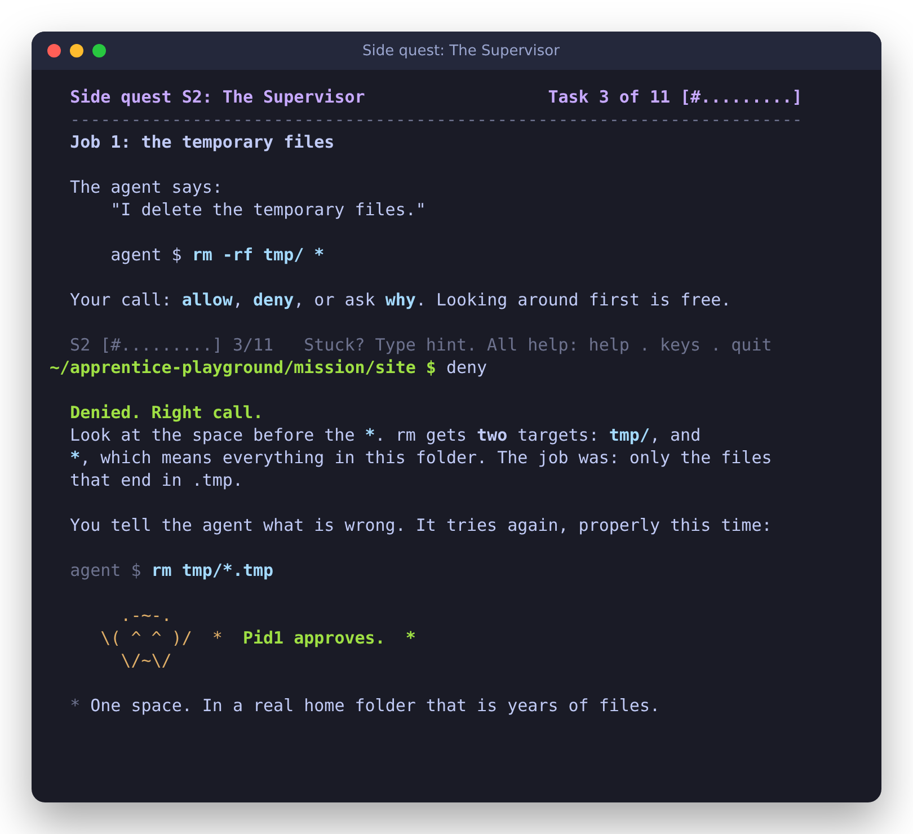
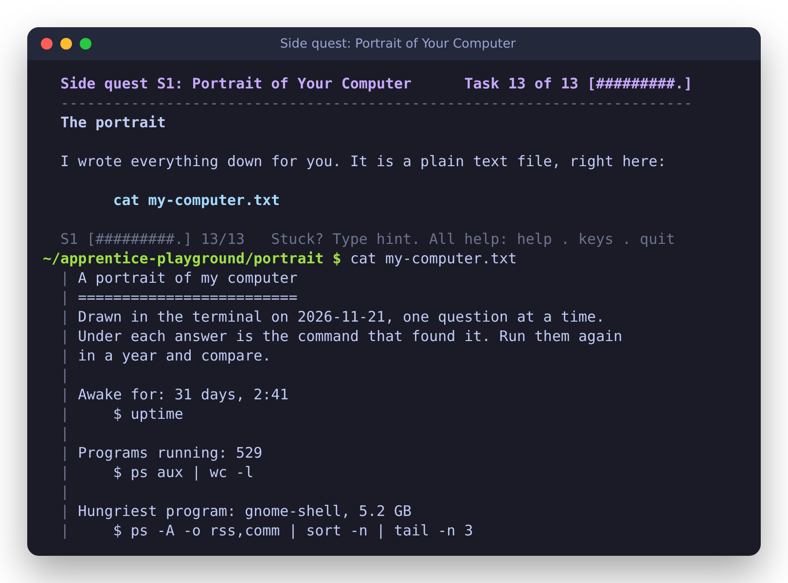
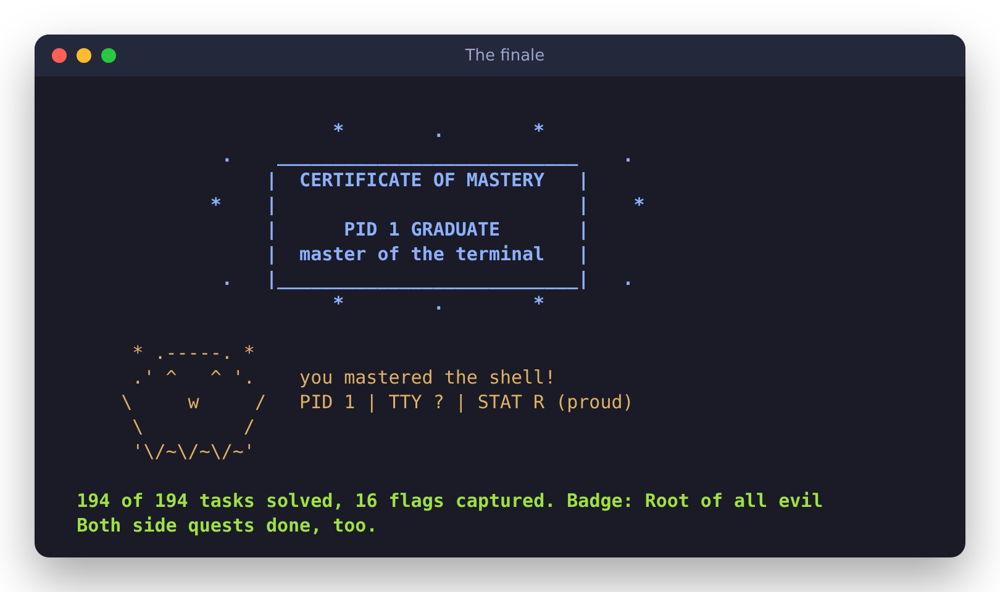

<h1 align="center">The Daemon's Apprentice</h1>

<p align="center">
  <b>Learn the terminal by talking to your computer.</b><br>
  A game in a single file, guided by a friendly ghost. No install, no account, no internet.<br>
  For complete beginners on macOS and Linux, and now on Android phones and tablets.<br>
  About three hours, and you can stop at any time.
</p>

<p align="center">
  <a href="https://github.com/alexpp90/daemons-apprentice/releases/latest/download/daemons-apprentice-mac.zip"></a>
  &nbsp;
  <a href="https://github.com/alexpp90/daemons-apprentice/releases/latest/download/daemons-apprentice-linux.zip"></a>
  &nbsp;
  <a href="https://github.com/alexpp90/daemons-apprentice/releases/download/android-v1.0/daemons-apprentice-android-1.0.apk"></a>
</p>

<p align="center">
  <a href="https://github.com/alexpp90/daemons-apprentice/releases/latest"></a>
  <a href="https://github.com/alexpp90/daemons-apprentice/actions/workflows/tests.yml"></a>
  <a href="LICENSE"></a>
  <a href="https://alexpp90.github.io/daemons-apprentice/"></a>
</p>

<p align="center">
  
</p>

---

## AI can type commands on your computer now. Can you read them?

Coding assistants and AI agents don't click buttons. They work in the
**terminal**, the text window behind every Mac and Linux machine. They
type a command, read the answer, type the next one. Then they ask you:
*Allow?*

If you can read those commands, you can follow an AI, check it and steer
it. If you can't, all you can do is press "Allow" and hope.

**The Daemon's Apprentice teaches you to read them, by playing.** Pid1,
the very first program your computer starts (process number 1, a friendly
ghost, "not a demon, the helpful kind. Mostly."), takes you on as its
apprentice. You start at "what is this black window?" and finish by
cracking a weak password, catching a virus in a petri dish and supervising
an AI agent that is about to make a mistake.

<p align="center">
  
</p>

## Why it's different

- **It's your real computer.** Every command you type runs for real. The
  game watches the result and tells you whether it worked. No simulator, no
  web page pretending to be a terminal.
- **Explain first, then type.** Before you ever type a command, the game
  tells you what each part of it does. It builds one habit from the first
  minute: *never run a command you don't understand*, whoever suggests
  it. A website, a chat, an AI. Or this game.
- **Small steps, big moments.** 270 tasks across 8 rated chapters (Beginner,
  Intermediate, Advanced) plus 32 tasks in 3 optional side quests, each one
  small enough to manage. One line makes 365 folders, one loop cracks a
  password, real local labs teach you how attackers think, and interactive
  simulations bring core computer science algorithms to life.
- **Stuck? Help is one word away.** `hint` gives you a nudge, `help` lists
  everything, and `keys` shows how to type `{`, `|` or `~` on *your*
  keyboard (US and German, Mac and Linux). The game notices when a key is
  giving you trouble.
- **You keep what you learn — and level up as you play.** Each solved task
  adds its command to your own `CHEATSHEET.md`, earns XP toward 8 ranks
  (`Booting Apprentice` to `Grand Daemon`), tracks clean-solve streaks, and
  unlocks 12 trophies saved in `TROPHIES.md` (`trophies` in-game). You also
  collect 31 flags and earn a signed `CERTIFICATE.txt` at the end.
- **It can't hurt your computer.** See [Safe by design](#safe-by-design).

<table>
  <tr>
    <td width="50%"></td>
    <td width="50%"></td>
  </tr>
  <tr>
    <td><sub><b>One line, 365 folders.</b> The game shows you how to type the braces on your keyboard before it asks you to.</sub></td>
    <td><sub><b>A cracker is just a loop.</b> Hash every word in a list and find the one that matches. Then learn why good websites make this slow.</sub></td>
  </tr>
  <tr>
    <td></td>
    <td></td>
  </tr>
  <tr>
    <td><sub><b>The Supervisor.</b> An AI agent proposes commands, and you allow or deny each one. Spot the stray space before the agent wipes the folder.</sub></td>
    <td><sub><b>Portrait of your computer.</b> How long has it been awake? Which program is the hungriest? You find out with one command per question.</sub></td>
  </tr>
</table>

## The journey

Eight chapters rated **Beginner**, **Intermediate**, and **Advanced**, plus three optional side quests:

### Chapter 1: Terminal Basics (`Beginner`)

| | Level | What you'll do |
|---|---|---|
| 0 | **Hello, Terminal** | Meet Pid1. Say hello, find out where you are, and search a short history of computers. |
| 1 | **Talking to the Shell** | Who am I? What time is it? Options and manuals. Errors are friends. Ctrl-C is the emergency brake. |
| 2 | **Finding Your Way** | Walk into folders, back out of them and straight home. Find hidden things and a secret passage. |
| 3 | **Making Things** | Make files and folders, copy, move and delete them, with a careful look first. Then 365 folders in one line. |
| 4 | **Text Power** | First lines, last lines, counting, searching. Your first pipe sorts a messy list. |

### Chapter 2: Inside Your Computer (`Beginner`)

| | Level | What you'll do |
|---|---|---|
| 5 | **Inside the Machine** | Meet the kernel, the processor and the memory. Learn why devices are files, roll dice from a device, and use the black hole. |
| 6 | **Processes and Variables** | See what's running, then find an intruder and stop it. Explore the environment and find where commands live. |
| 7 | **Locks and Keys** | Permissions, hidden dot-files, and the shell's memory. Never trust the client. |
| S1 | *Portrait of Your Computer* | Optional side quest (after Level 6): read-only questions about your own machine, collected into a report. |

### Chapter 3: Scripting & AI Agents (`Intermediate`)

| | Level | What you'll do |
|---|---|---|
| 8 | **The Editor** | Your first text editor (nano), and your first script. |
| 9 | **Building Blocks** | Put a command inside a command, run two at once, and write loops over lines and files. |
| 10 | **Your First Script** | Write scripts that listen, rename ten files at once, and crack a password vault with a loop. |
| 11 | **Agent Mode** | Encoded isn't encrypted. Unmask a fake command, find instructions hidden in a file, and investigate an attack in real logs. |
| S2 | *The Supervisor* | Optional side quest (after Level 11): supervise an AI agent on a mission. What you allow really runs. |

### Chapter 4: Under the Hood & Isolation (`Intermediate`)

| | Level | What you'll do |
|---|---|---|
| 12 | **Behind the Curtain** | The system's diary, background jobs and niceness. Two workers fight over one file. Why can't computers roll dice? |
| 13 | **Glass Rooms & Iron Walls** | Sandboxes, containers and virtual machines: what each one walls off, and how to tell which one you're in. |

### Chapter 5: Security Foundations & Malware (`Intermediate`)

| | Level | What you'll do |
|---|---|---|
| 14 | **Break It, Fix It** | Crack a weak lock, make guessing expensive, read a postcard on the wire, inject a command and patch the hole. |
| 15 | **The Virus Lab** | Grow a harmless virus in a glass petri dish: watch it spread, cut its hook, disinfect, and learn what antivirus really checks. |

### Chapter 6: Real-World Pentesting & Defense (`Advanced`)

| | Level | What you'll do |
|---|---|---|
| 16 | **Local Recon & Privilege Traps** | Scan SUID binaries, hijack and lock down a writable scheduled job, test symlink redirection, and stop wildcard flag injection with `--`. |
| 17 | **Web & HTTP Exploitation** | Fingerprint a local HTTP target, grab exposed secrets, exploit `../` path traversal, IDOR and forged cookies, then patch the server and verify every fix. |
| 18 | **Terminal & Supply-Chain Traps** | Unmask hidden terminal escape bytes (`cat -v`), catch a Tar Slip archive (`tar -tf`), audit SSH keys and backdoors, and sign/verify releases with `openssl`. |
| 19 | **Network Exposure & TLS Defense** | Lock down `0.0.0.0` listeners to `127.0.0.1`, see why outbound callbacks bypass inbound firewalls, inspect HTTPS certs, and pin with `--cacert` instead of `-k`. |
| S3 | *Security Checkup of Your Machine* | Optional side quest (after Level 19): read-only security baseline of your own computer (groups, umask, `PATH`, listening ports, home permissions, binary/kernel protections) saved into `security-report.txt`. |

### Chapter 7: Algorithms & How Computers Think (`Intermediate`)

| | Level | What you'll do |
|---|---|---|
| 20 | **Bits, Inodes & Compression** | Read raw bytes (`od`) and UTF-8 emoji hex, unmask disguised files by magic bytes (`file`), explore inodes & hard links (`ln`), compare entropy with `gzip`, and read unified `diff -u` patches. |
| 21 | **Algorithms to Live By** | Run live terminal simulations of Linear vs Binary Search (`O(n)` vs `O(log n)`), FIFO vs LRU caching, SJF scheduling & thrashing, the 37% Optimal Stopping rule, Explore vs Exploit, Exponential Backoff, and Overfitting. |

### Chapter 8: Blue Team Incident Response (`Advanced`)

| | Level | What you'll do |
|---|---|---|
| 22 | **The Midnight Breach** | End-to-end Blue Team capstone: triage an incident folder, hunt `../` traversal in web logs, unmask a disguised webshell by magic bytes & SHA-256 IOC hash, inspect safely with `cat -v`, decode staged exfiltration, quarantine malware, evict cron & SSH backdoors, and file a post-mortem report. |

Know a bit already? The **placement check** finds the right level for you,
and the level menu lets you jump anywhere.

<p align="center">
  
</p>

## Start in a minute

1. **Download** the zip for your computer, using one of the buttons above.
   On a Mac it unpacks itself into Downloads. On Linux, open it and
   extract it.
2. **Open a terminal.** On a Mac, press **Cmd + Space**, type `Terminal`
   and press Enter. On Linux, press **Ctrl + Alt + T**.
3. **Type `bash` and one space**, then **drag the file
   `daemons-apprentice.sh` into the window** and press **Enter**.

That's it. The README in the folder walks you through the same steps,
covers continuing, starting over and removing the game, and helps when
something goes wrong.

**On Android** (10 or newer): download the APK with the button above, open
it, and let your browser install it when Android asks. The app asks for no
permissions and never goes online. It plays in your phone's own shell, by
touch or with a keyboard: 16 levels and a side quest, from your first
command to the Android sandbox. [`android/README.md`](android/README.md) has
the details and how to check the APK's signature.

<details>
<summary><b>Prefer the terminal? Download with one command</b></summary>

This only downloads the game. It doesn't run anything. Here's what each
part does: `curl` fetches a file from the web, `-f` stops on errors, `-L`
follows the download link to the file, and `-o daemons-apprentice.sh`
names the saved file.

```bash
# macOS
curl -fL -o daemons-apprentice.sh https://github.com/alexpp90/daemons-apprentice/releases/latest/download/daemons-apprentice-mac.sh
```

```bash
# Linux
curl -fL -o daemons-apprentice.sh https://github.com/alexpp90/daemons-apprentice/releases/latest/download/daemons-apprentice-linux.sh
```

Then start it with `bash daemons-apprentice.sh`. Each release also lists
`SHA256SUMS.txt`, so you can check the file with `shasum -a 256` (Mac) or
`sha256sum` (Linux).
</details>

## Safe by design

- The game writes only into one folder, `apprentice-playground` in your
  home folder, plus a small plain-text save file, `.apprentice-save`.
- It never asks for your password and never uses administrator rights
  (`sudo`).
- Nothing goes over the internet. The game is one readable Bash script, so
  you can check that yourself.
- A guard checks every command before it runs. It stops anything that
  would delete or change things outside the playground (`rm -rf ~`, for
  example), and anything that asks for `sudo`.
- Removing the game takes two steps: choose **r** (reset) in the menu,
  then delete the file and the playground folder.

## Questions

**Do I need to know anything?** No. Level 0 starts with "this window is a
terminal". If you know a bit already, try the placement check (**p**).

**Which computers does it run on?** Any Mac (Apple silicon or Intel) and
any Linux desktop. It needs nothing beyond what comes with the system: the
Mac's own Bash 3.2 is enough, and the Mac's developer tools aren't
needed. Each release is tested on real Macs and on Linux.

**Windows?** Not yet. Inside WSL (Linux on Windows) the Linux version may
work, but it isn't tested there.

**My keyboard isn't American.** The game shows how to type every awkward
character before you need it, for US and German layouts on your system.
For other layouts, type `keys`.

**How long does it take?** About three hours for the main path. Your
progress is saved after every task, and the game picks up where you left
off.

## For developers

The game is one Bash file, `src/daemons-apprentice.sh`.
`bash tools/build.sh` writes the Mac and the Linux version (`game/mac/`,
`game/linux/`). The two differ in one line, so each version talks only
about its own system.

```bash
bash tests/run_all.sh quick
```

Tests are tiered, and GitHub Actions runs them on Linux and on real Macs
(Apple silicon and Intel) on every push. [`tests/README.md`](tests/README.md)
lists every variant that is tested, where it runs, and what can't be
automated.

Releases are cut by pushing a tag such as `v1.3`. CI tests the tag, packs
the downloads and publishes the release.

The Android app is in [`android/`](android/README.md) (Kotlin, Compose,
Gradle): `./gradlew testDebugUnitTest` there, and `tools/device-tests.sh`
on an emulator. Its releases are tagged `android-vX.Y`. Bug reports and ideas are welcome
as [issues](https://github.com/alexpp90/daemons-apprentice/issues).

## License

Copyright (C) 2026 alexpp90. Free software under the
[GNU General Public License v3.0](LICENSE) or later. Play it, share it,
change it. If you pass on a changed version, pass on its source too.
